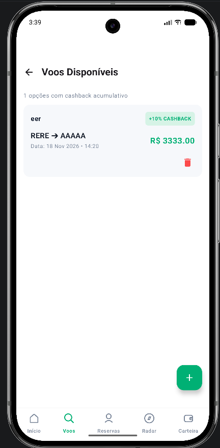
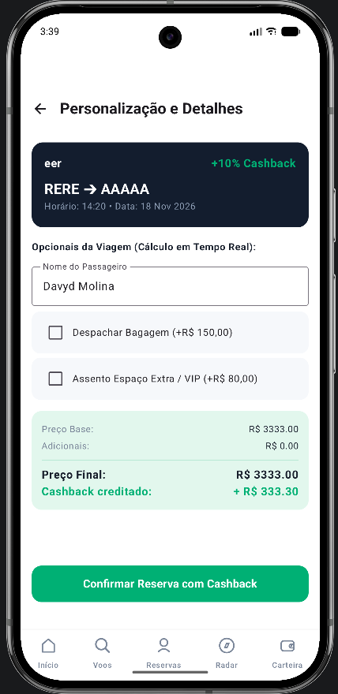
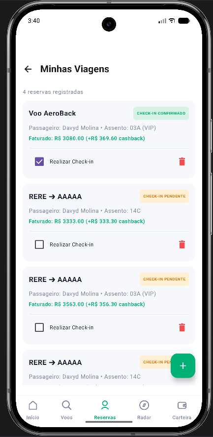
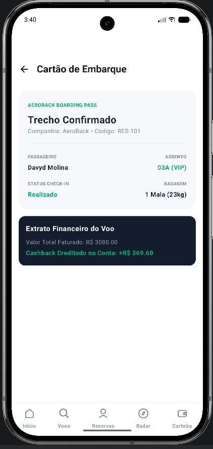

# AeroBack — Trabalho 3: Persistência de Dados com Room

Aplicativo Android nativo desenvolvido em **Kotlin** e **Jetpack Compose** voltado para busca, emissão e gestão de passagens aéreas com programa integrado de cashback acumulativo e persistência de dados local em banco **SQLite** via **Android Jetpack Room**.

## Integrantes do Grupo

* **Integrante 1:** Davyd Eduardo Ferreira Molina — RA / Matrícula: `42284805`
* **Integrante 2:** Guilherme Brunetti — RA / Matrícula: `042261015`

---

## Tecnologias e Dependências

* **Linguagem:** Kotlin 2.2.10
* **Processador de Anotações:** Google KSP (`id("com.google.devtools.ksp") version "2.2.10-2.0.2"`)
* **Persistência de Dados Local:** Android Jetpack Room (`androidx.room:room-runtime:2.8.5`, `androidx.room:room-ktx:2.8.5`, `ksp("androidx.room:room-compiler:2.8.5")`)
* **Concorrência e Assincronismo:** Kotlin Coroutines (`CoroutineScope(Dispatchers.IO).launch { ... }`) + `LaunchedEffect(Unit)` + tratamento de exceções (`try / catch` com `Log.e(...)`)
* **Toolkit UI & Design:** Jetpack Compose + Material Design 3
* **Navegação:** Navigation Compose (`androidx.navigation:navigation-compose:2.8.5`) com passagem de `id: Int` via rota parametrizada (`NavType.IntType`)

---

## Como Rodar o Projeto

### Pré-requisitos

* **Android Studio** (versão Ladybug / Meerkat ou superior).
* **JDK 17** configurado no Gradle.
* **Emulador Android** ou dispositivo físico com **API 26+ (Android 8.0+)**.

### Passo a Passo

1. Clone o repositório:
   ```bash
   git clone https://github.com/davyd9/Aero-Back-segunda-entrega.git
   ```
2. Abra o **Android Studio** e selecione **File > Open**, apontando para a pasta raiz do projeto.
3. Aguarde a sincronização automática do Gradle (**Sync Project with Gradle Files**), que configurará o plugin KSP e as dependências do Room.
4. Selecione o emulador ou aparelho físico e clique em **Run 'app'** (`Shift + F10`).

### Como Testar a Persistência (Teste de Aceitação — Seção 3.2)

1. Abra o app e acesse a aba **Voos** (`TelaListaVoos`) ou **Reservas** (`TelaListaReservas`).
2. Toque no botão **`+`** (canto inferior direito) e adicione um novo Voo ou uma nova Reserva.
3. Teste também a edição (ícone de lápis) e a exclusão (ícone de lixeira), ou clique em um item para abrir a **Tela de Detalhes** (`TelaDetalhesVoo` / `TelaCartaoEmbarque`), que busca o registro diretamente no banco pelo `id: Int` (`dao.buscarPorId(id)`).
4. **Feche o aplicativo completamente** (remova-o da lista de apps recentes do Android) e **abra novamente**: todos os itens adicionados e editados permanecem salvos no banco SQLite/Room.

---

## Documentação do Processo e das Decisões (Seção 4)

### 1. Como estava o projeto no Trabalho 2, e o que mudou para chegar até aqui?

* **Como estava no Trabalho 2 (MAF):** O aplicativo já possuía navegação real com `NavHost` e `BottomNavigation` entre as telas de Busca, Catálogo de Voos, Detalhes do Voo, Minhas Viagens (Reservas), Cartão de Embarque, Radar de Preços e Carteira de Cashback. Porém, as listas de `Voo` e `Reserva` viviam exclusivamente na memória RAM através de `mutableStateListOf(...)` dentro da `MainActivity`. Ao fechar ou destruir a `Activity`, todos os voos cadastrados e reservas emitidas eram perdidos.
* **O que mudou no Trabalho 3:**
  1. Configuramos o plugin **KSP** (`com.google.devtools.ksp`) e as dependências do **Room** (`room-runtime`, `room-ktx` e `ksp("androidx.room:room-compiler:$room_version")`).
  2. Adaptamos as duas `data class` do Trabalho 2 (`Voo` e `Reserva`) para entidades do Room anotadas com `@Entity(tableName = "voos")` e `@Entity(tableName = "reservas")`, adicionando chave primária inteira autogerada (`@PrimaryKey(autoGenerate = true) val id: Int = 0`).
  3. Criamos duas interfaces `@Dao` (`VooDao` e `ReservaDao`), todas com funções `suspend fun` para `@Insert`, `@Query` (`buscarTodos` e `buscarPorId`), `@Update` e `@Delete`.
  4. Criamos a classe `AppDatabase : RoomDatabase()` seguindo o padrão **Singleton** (`companion object` + `@Volatile` + `synchronized`).
  5. Removemos o `mutableStateListOf` centralizado e passamos a carregar os dados diretamente do banco em cada tela com `LaunchedEffect(Unit)` e executar todas as operações de banco dentro de `CoroutineScope(Dispatchers.IO).launch { ... }` com tratamento de erro (`try/catch` e `Log.e(...)`).
  6. Implementamos a edição completa (`@Update`) na UI tanto para `Voo` quanto para `Reserva`, além da busca direta por `id` no banco (`buscarPorId(id: Int)`) nas duas telas de Detalhes (`TelaDetalhesVoo` e `TelaCartaoEmbarque`).

---

### 2. Quais Entity, DAO e Database foram criados — e por que escolheram esses campos para cada Entity?

* **Entidades (`ModelosDados.kt`):**
  1. **`Voo` (`@Entity(tableName = "voos")`)**:
     * `id: Int = 0` (`@PrimaryKey(autoGenerate = true)`): Identificador único autogerado pelo SQLite para cada rota aérea.
     * `companhia: String`: Nome da companhia aérea (ex.: LATAM, Gol, Azul).
     * `origem: String` e `destino: String`: Códigos IATA dos aeroportos do trecho (ex.: `GRU`, `MIA`, `CWB`).
     * `dataIda: String` e `horario: String`: Data e horário programados do voo.
     * `precoBase: Double`: Tarifa base usada como ponto de partida para o cálculo da passagem.
     * `cashbackPorcento: Int`: Percentual de retorno financeiro oferecido naquele voo.
  2. **`Reserva` (`@Entity(tableName = "reservas")`)**:
     * `id: Int = 0` (`@PrimaryKey(autoGenerate = true)`): Identificador único autogerado do bilhete/reserva.
     * `vooId: Int`: Referência ao `id` do `Voo` reservado, permitindo cruzar os dados do bilhete com o trecho aéreo.
     * `passageiro: String` e `assento: String`: Dados nominais do viajante e poltrona escolhida.
     * `bagagemDespachada: Boolean` e `assentoVip: Boolean`: Opcionais contratados na emissão.
     * `precoFinal: Double` e `cashbackGanho: Double`: Valores financeiros consolidados da reserva, utilizados pela Carteira Digital (`TelaCarteiraCashback`) e pela Home (`TelaBuscaVoos`) para calcular o saldo disponível e pendente.
     * `checkInRealizado: Boolean = false`: Status do check-in, que pode ser atualizado via `@Update` na lista ou no Cartão de Embarque.
* **DAOs e Database (`BancoDadosRoom.kt`):**
  * **`VooDao` (`@Dao`)** e **`ReservaDao` (`@Dao`)**: Interfaces responsáveis pelo mapeamento objeto-relacional de cada tabela.
  * **`AppDatabase` (`@Database(entities = [Voo::class, Reserva::class], version = 1)`)**: Classe abstrata que estende `RoomDatabase()`, expõe `vooDao()` e `reservaDao()` e implementa o padrão Singleton thread-safe (`@Volatile private var INSTANCE` + `synchronized(this)`).

---

### 3. Como decidiram estruturar as queries do DAO (quais métodos além dos 4 básicos, se houver)?

Cada um dos dois DAOs (`VooDao` e `ReservaDao`) implementa os **4 métodos CRUD básicos** marcados como `suspend fun`, além da **consulta filtrada por campo (`id`)** exigida nas seções 3.1 e 3.3:

* **Em `VooDao`:**
  * `@Insert suspend fun inserir(voo: Voo)`
  * `@Query("SELECT * FROM voos ORDER BY id ASC") suspend fun buscarTodos(): List<Voo>`
  * `@Query("SELECT * FROM voos WHERE id = :id") suspend fun buscarPorId(id: Int): Voo?` *(consulta adicional filtrando por `id` usada na `TelaDetalhesVoo`)*
  * `@Update suspend fun atualizar(voo: Voo)`
  * `@Delete suspend fun deletar(voo: Voo)`
* **Em `ReservaDao`:**
  * `@Insert suspend fun inserir(reserva: Reserva)`
  * `@Query("SELECT * FROM reservas ORDER BY id DESC") suspend fun buscarTodos(): List<Reserva>`
  * `@Query("SELECT * FROM reservas WHERE id = :id") suspend fun buscarPorId(id: Int): Reserva?` *(consulta adicional filtrando por `id` usada na `TelaCartaoEmbarque`)*
  * `@Update suspend fun atualizar(reserva: Reserva)`
  * `@Delete suspend fun deletar(reserva: Reserva)`

---

### 4. Qual foi a dificuldade em migrar de `mutableStateListOf` para Room? O que quebrou no caminho e como resolveram?

1. **Mudança do tipo do `id` de `String` (`UUID`) para `Int` autogerado (`@PrimaryKey(autoGenerate = true)`):**
   * *O que quebrou:* No Trabalho 2, os IDs eram gerados em memória com `UUID.randomUUID().toString()` e passados nas rotas de navegação como `NavType.StringType`. Ao migrar para `val id: Int = 0` com `autoGenerate = true`, as rotas `flight_detail/{flightId}` e `booking_detail/{bookingId}` precisaram ser atualizadas para `NavType.IntType` (`backStackEntry.arguments?.getInt(...)`) e as funções auxiliares em `RotasNavegacao.kt` passaram a receber `Int`.
2. **Sincronização da UI após operações assíncronas em `Dispatchers.IO`:**
   * *O que quebrou:* Com `mutableStateListOf`, chamar `voos.add(...)` ou `voos.remove(...)` atualizava a tela na mesma hora na thread principal. Com o Room, as funções do DAO são `suspend` e rodam em background (`CoroutineScope(Dispatchers.IO).launch`).
   * *Como resolvemos:* Após cada `dao.inserir(...)`, `dao.atualizar(...)` ou `dao.deletar(...)` dentro do `Dispatchers.IO`, buscamos a lista atualizada com `dao.buscarTodos()` e usamos `withContext(Dispatchers.Main)` para atualizar o estado `mutableStateOf` da tela, garantindo que a interface reflita imediatamente a mudança sem travar a Main Thread.
3. **Telas de Detalhes buscando direto do banco (Seção 3.3):**
   * *O que quebrou:* Antes, `TelaDetalhesVoo` e `TelaCartaoEmbarque` recebiam a lista inteira por parâmetro e faziam `.find { it.id == id }`.
   * *Como resolvemos:* Removemos as listas dos parâmetros dessas telas. Agora elas recebem apenas o `flightId: Int` (ou `bookingId: Int`) pela navegação e, dentro de um `LaunchedEffect(Unit)`, executam `vooDao.buscarPorId(flightId)` / `reservaDao.buscarPorId(bookingId)` em `Dispatchers.IO`.

---

### 5. Prints e Vídeo mostrando o teste de persistência (Adicionar, Editar, Remover, Fechar e Reabrir o App)

🔗 **Link da Apresentação / Demonstração com Vídeos (Canva / Slides):** [https://canva.link/b155s2fcb1umoiu](https://canva.link/b155s2fcb1umoiu)

#### 1. Busca de Voos e Saldo Calculado do Room (`TelaBuscaVoos`)


#### 2. Catálogo de Voos Disponíveis — CRUD com Room (`TelaListaVoos`)


#### 3. Detalhes do Voo Lendo por ID do Banco e Cálculo em Tempo Real (`TelaDetalhesVoo`)


#### 4. Cartão de Embarque Lendo por ID do Banco (`TelaCartaoEmbarque`)


---

### 6. Algum integrante teve dificuldade em algum ponto? Como resolveram?

* **Configuração do KSP com a versão do Kotlin do projeto:** Inicialmente houve dúvida sobre a compatibilidade entre o processador de anotações e a versão do Kotlin configurada no Gradle (`2.2.10`), além da ordem correta de sincronização do plugin `id("com.google.devtools.ksp")`. Resolvemos alinhando a versão do plugin KSP (`2.2.10-2.0.2`) exatamente com a versão do Kotlin no `build.gradle.kts` raiz, aplicando `id("com.google.devtools.ksp")` no `app/build.gradle.kts` antes da dependência `ksp("androidx.room:room-compiler:$room_version")`.
* **Carga inicial (*Seed*) sem duplicar dados ao reabrir o app:** Na primeira vez que o app abre, queríamos que já existissem voos de exemplo no banco, mas sem recriá-los caso o usuário deletasse ou editasse itens e fechasse o app. Resolvemos criando a função `AppDatabase.garantirDadosIniciais(context, db)` protegida por `Mutex` e `SharedPreferences`, que popula os registros iniciais no SQLite apenas na primeira execução após a instalação.

---

## Checklist de Entrega (Seção 7)

- [x] Novo repositório GitHub criado, com `README.md` explicando como rodar o projeto
- [x] Documentação do processo e das decisões está no repositório, com prints/vídeo (seção 4)
- [x] Dependências do Room configuradas (`room-runtime`, `room-ktx`, `ksp("androidx.room:room-compiler:$room_version")`) e o projeto compila sem erro
- [x] Existem no mínimo 2 `@Entity` (`Voo` e `Reserva`), cada uma com `@PrimaryKey(autoGenerate = true) val id: Int = 0`
- [x] Existem no mínimo 2 interfaces `@Dao` (`VooDao` e `ReservaDao`), cada uma com `@Insert`, `@Query`, `@Update` e `@Delete` (todos `suspend`)
- [x] Pelo menos um DAO tem uma consulta filtrada por campo (`buscarPorId(id: Int)` em ambos os DAOs), além do `buscarTodos()`
- [x] Tela de Detalhes (`TelaDetalhesVoo` e `TelaCartaoEmbarque`) busca o item direto do banco pelo `id` recebido na navegação (seção 3.3)
- [x] Existe uma classe `AppDatabase` em padrão Singleton (`companion object` + `@Volatile` + `synchronized`)
- [x] As listas buscam os dados do banco ao abrir a tela com `LaunchedEffect(Unit)` (não mais de uma lista fixa em memória)
- [x] Adicionar um item pela UI salva de verdade no banco (`dao.inserir(...)`)
- [x] Editar (atualizar) um item pela UI funciona de verdade e persiste (`dao.atualizar(...)`)
- [x] Remover um item pela UI apaga de verdade do banco (`dao.deletar(...)`)
- [x] Testado: adicionar um item, fechar o app, reabrir — o item continua lá
- [x] Toda operação de banco está dentro de uma Coroutine no `Dispatchers.IO` (`CoroutineScope(Dispatchers.IO).launch { ... }`) com `try/catch` e `Log.e(...)`
