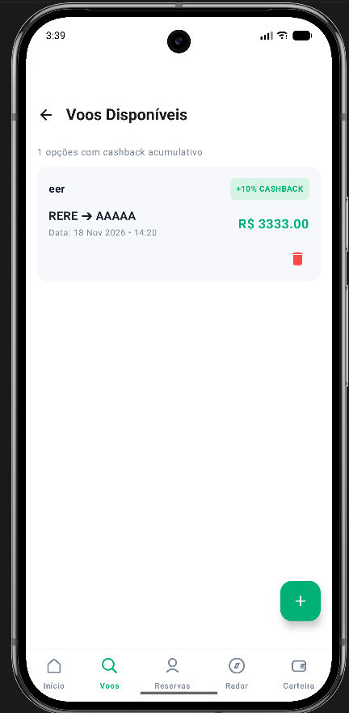
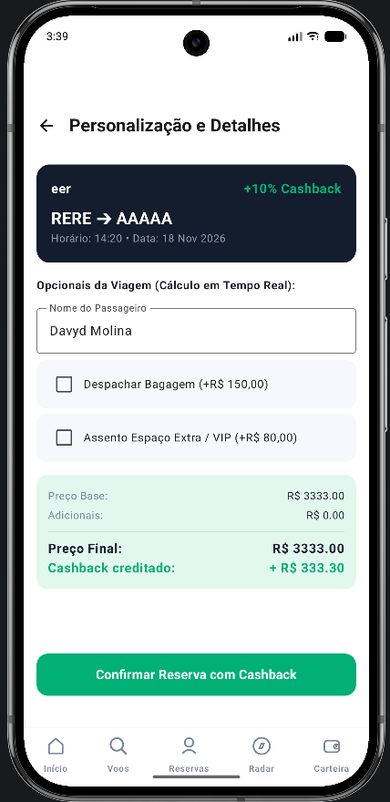
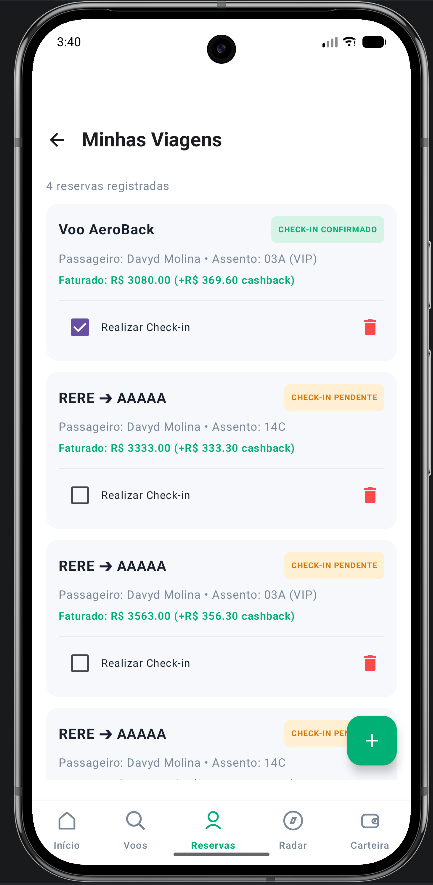
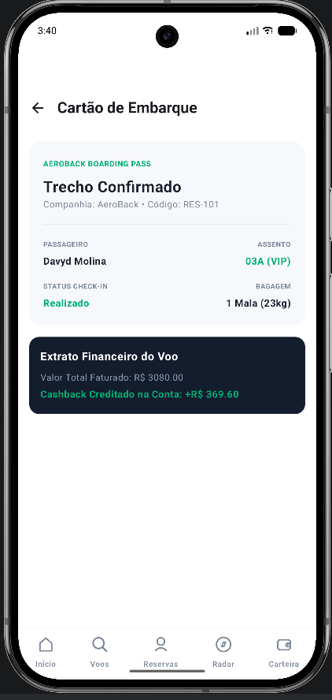

# AeroBack — Trabalho 4: Arquitetura MVVM com Room, Repository e StateFlow

Aplicativo Android nativo desenvolvido em **Kotlin** e **Jetpack Compose** voltado para busca, emissão e gestão de passagens aéreas com programa integrado de cashback acumulativo, persistência local em **SQLite** via **Android Jetpack Room** e arquitetura em camadas **MVVM (Model — View — ViewModel)** reativa com **Repository**, **Kotlin Flow / StateFlow** e **ViewModelProvider.Factory**.

## Integrantes do Grupo

* **Integrante 1:** Davyd Eduardo Ferreira Molina — RA / Matrícula: `42284805`
* **Integrante 2:** Guilherme Brunetti — RA / Matrícula: `042261015`

---

## Tecnologias e Dependências

* **Linguagem:** Kotlin 2.2.10
* **Processador de Anotações:** Google KSP (`id("com.google.devtools.ksp") version "2.3.6"`) + Android Gradle Plugin `9.3.3` (Built-in Kotlin)
* **Arquitetura & Ciclo de Vida:** MVVM + `ViewModel` + `StateFlow` / `UiState` + `ViewModelProvider.Factory` (`androidx.lifecycle:lifecycle-viewmodel-compose:2.8.7`, `androidx.lifecycle:lifecycle-viewmodel-ktx:2.8.7`)
* **Persistência de Dados Local Reativa:** Android Jetpack Room (`androidx.room:room-runtime:2.8.5`, `androidx.room:room-ktx:2.8.5`, `ksp("androidx.room:room-compiler:2.8.5")`) com queries retornando `Flow<List<...>>`
* **Concorrência e Assincronismo:** `viewModelScope.launch { ... }` + `Kotlin Flow` (`MutableStateFlow` / `StateFlow` / `combine`) + tratamento de exceções (`try / catch` com `Log.e(...)`)
* **Toolkit UI & Design:** Jetpack Compose + Material Design 3
* **Navegação:** Navigation Compose (`androidx.navigation:navigation-compose:2.8.5`) com passagem de `id: Int` via rota parametrizada (`NavType.IntType`)

---

## Estrutura de Pacotes (MVVM)

```text
com.example.aeroback/
├── MainActivity.kt                        # Ponto de entrada, criação dos Repositories, Factories e NavHost
├── data/                                  # Camada de Dados Local (Room)
│   ├── Voo.kt                             # @Entity(tableName = "voos")
│   ├── Reserva.kt                         # @Entity(tableName = "reservas")
│   ├── VooDao.kt                          # @Dao com buscarTodos() / listarVoos() retornando Flow<List<Voo>>
│   ├── ReservaDao.kt                      # @Dao com buscarTodos() / listarReservas() retornando Flow<List<Reserva>>
│   ├── AeroBackDatabase.kt                # @Database RoomDatabase em padrão Singleton
│   └── repository/                        # Única Fonte de Verdade (Single Source of Truth)
│       ├── VooRepository.kt               # Mediação exclusiva com VooDao
│       └── ReservaRepository.kt           # Mediação exclusiva com ReservaDao
├── viewmodel/                             # Estado da UI, Regras de Negócio e Injeção
│   ├── VooUiState.kt                      # Estado imutável agrupado das telas de Voos, Busca e Radar
│   ├── ReservaUiState.kt                  # Estado imutável agrupado das telas de Reservas, Embarque e Carteira
│   ├── VooViewModel.kt                    # StateFlow encapsulado (_uiState / uiState) + ações de Voo
│   ├── ReservaViewModel.kt                # StateFlow encapsulado (_uiState / uiState) + ações de Reserva
│   ├── VooViewModelFactory.kt             # ViewModelProvider.Factory para VooViewModel
│   └── ReservaViewModelFactory.kt         # ViewModelProvider.Factory para ReservaViewModel
└── ui/                                    # Camada de Apresentação Pura (@Composable)
    ├── TelaBuscaVoos.kt                   # Home / Busca de passagens e card de saldo acumulado
    ├── TelaListaVoos.kt                   # Catálogo de voos disponíveis (CRUD reativo)
    ├── TelaDetalhesVoo.kt                 # Detalhes do voo por ID + cálculo em tempo real + emissão
    ├── TelaListaReservas.kt               # Minhas viagens (CRUD reativo + check-in rápido)
    ├── TelaCartaoEmbarque.kt              # Cartão de embarque por ID + check-in + cancelamento
    ├── TelaRadarPrecos.kt                 # Monitoramento e filtros de preço/cashback
    ├── TelaCarteiraCashback.kt            # Carteira digital (saldo liberado vs. pendente + extrato)
    ├── ComponentesNavegacao.kt            # Barra inferior customizada (CustomBottomNavigation)
    ├── RotasNavegacao.kt                  # Constantes e builders de rotas do NavHost
    ├── Cores.kt                           # Paleta visual da marca AeroBack
    └── theme/                             # Tipografia e tema base Material 3
```

---

## Como Rodar o Projeto

### Pré-requisitos

* **Android Studio** (versão Ladybug / Meerkat ou superior).
* **JDK 17** configurado no Gradle.
* **Emulador Android** ou dispositivo físico com **API 26+ (Android 8.0+)**.

### Passo a Passo

1. Clone o repositório:
   ```bash
   git clone https://github.com/davyd9/Aero-Back-segunda-entrega.git
   ```
2. Abra o **Android Studio** e selecione **File > Open**, apontando para a pasta raiz do projeto.
3. Aguarde a sincronização automática do Gradle (**Sync Project with Gradle Files**), que configurará o KSP, Room e `lifecycle-viewmodel-compose`.
4. Selecione o emulador ou aparelho físico e clique em **Run 'app'** (`Shift + F10`).

### Como Testar (CRUD Reativo + Persistência MVVM)

1. Abra o app e acesse a aba **Voos** (`TelaListaVoos`) ou **Reservas** (`TelaListaReservas`).
2. Toque no botão **`+`** e adicione um novo Voo ou Reserva — observe que a lista e o saldo na Home/Carteira atualizam automaticamente via `Flow` / `StateFlow`, sem recarregamento manual.
3. Teste a edição (ícone de lápis), o check-in (checkbox ou botão no Cartão de Embarque) e a exclusão (ícone de lixeira), além da abertura de **Detalhes** (`TelaDetalhesVoo` e `TelaCartaoEmbarque`) buscando o registro por `id` via `ViewModel` -> `Repository`.
4. **Feche o aplicativo completamente** e **reabra**: todos os dados permanecem persistidos no SQLite/Room.

---

## Documentação do Processo e das Decisões — Trabalho 4 (Seção 4)

### 1. Como estava o projeto no Trabalho 3, e o que mudou na reorganização?

* **Como estava no Trabalho 3:** Todos os arquivos principais ficavam juntos na raiz do pacote `com.example.aeroback`. As próprias telas `@Composable` instanciavam `AppDatabase.getDatabase(context)` e chamavam `vooDao` e `reservaDao` diretamente, disparando corrotinas manuais com `CoroutineScope(Dispatchers.IO).launch` e `withContext(Dispatchers.Main)` em cada clique de botão. Além disso, o estado de cada tela ficava espalhado em diversas variáveis `remember { mutableStateOf(...) }` soltas, e após cada `inserir`, `atualizar` ou `deletar` a tela precisava chamar `dao.buscarTodos()` manualmente para atualizar a lista.
* **O que mudou no Trabalho 4 (MVVM):**
  1. Reorganizamos 100% do código em 4 pacotes bem definidos (`data`, `data.repository`, `viewmodel` e `ui`), mantendo todas as 7 telas, cores, layouts e regras de negócio intactas.
  2. As consultas de listagem nos DAOs (`buscarTodos()` / `listarVoos()` e `listarReservas()`) deixaram de ser `suspend fun` pontuais e passaram a retornar `Flow<List<...>>` reativo.
  3. Criamos `VooRepository` e `ReservaRepository` como única ponte autorizada para conversar com os DAOs.
  4. Criamos `VooViewModel` (com `VooUiState`) e `ReservaViewModel` (com `ReservaUiState`), expondo estado imutável via `StateFlow` (`_uiState` privado + `uiState` público) e executando todas as escritas e buscas por ID dentro de `viewModelScope.launch`.
  5. Criamos `VooViewModelFactory` e `ReservaViewModelFactory` implementando `ViewModelProvider.Factory` para injetar os repositórios nos ViewModels.
  6. Limpamos completamente as telas `@Composable`: removemos todas as referências a `Dao`, `Database`, `CoroutineScope` e `Dispatchers.IO`. Agora as telas apenas observam `uiState.collectAsState()` e invocam funções de evento dos ViewModels.

---

### 2. Como a dupla decidiu dividir os pacotes — o que foi para `ui`, `data`, `data.repository` e `viewmodel`?

Dividimos os pacotes seguindo estritamente a responsabilidade de cada camada da arquitetura MVVM:

* **`com.example.aeroback.data`**: Contém toda a infraestrutura de banco de dados local do Room — as entidades `Voo.kt` e `Reserva.kt` (`@Entity`), as interfaces de acesso `VooDao.kt` e `ReservaDao.kt` (`@Dao`), e a classe abstrata `AeroBackDatabase.kt` (`@Database` em padrão Singleton apontando para `aeroback_room_v1.db`).
* **`com.example.aeroback.data.repository`**: Contém `VooRepository.kt` e `ReservaRepository.kt`, que recebem seus respectivos DAOs por construtor e expõem os fluxos reativos (`Flow`) e operações `suspend` de leitura por ID, contagem e escrita.
* **`com.example.aeroback.viewmodel`**: Contém as classes de estado imutável (`VooUiState.kt` e `ReservaUiState.kt`), os gerenciadores de estado e regras de negócio (`VooViewModel.kt` e `ReservaViewModel.kt`), e as fábricas de criação com injeção de dependência (`VooViewModelFactory.kt` e `ReservaViewModelFactory.kt`).
* **`com.example.aeroback.ui`**: Contém exclusivamente código visual e de navegação em Jetpack Compose — as 7 telas (`TelaBuscaVoos.kt`, `TelaListaVoos.kt`, `TelaDetalhesVoo.kt`, `TelaListaReservas.kt`, `TelaCartaoEmbarque.kt`, `TelaRadarPrecos.kt` e `TelaCarteiraCashback.kt`), componentes compartilhados (`ComponentesNavegacao.kt`), rotas (`RotasNavegacao.kt`), paleta (`Cores.kt`) e o subpacote `ui.theme`. A `MainActivity.kt` permaneceu na raiz `com.example.aeroback` atuando como ponto de entrada e montagem do grafo de navegação e das factories.

---

### 3. Por que o `Repository` existe — o que ele resolve que não existia antes?

Antes, cada tela conhecia detalhes internos do Room (`AeroBackDatabase` e métodos específicos do `@Dao`). O **Repository** resolve isso atuando como a **Única Fonte de Verdade (*Single Source of Truth*)** e desacoplando a origem dos dados do restante do aplicativo:

1. **Isolamento de mudanças na fonte de dados:** Se no futuro o AeroBack passar a buscar tarifas aéreas em uma API REST remota (Retrofit) usando o Room apenas como cache offline, apenas `VooRepository` e `ReservaRepository` precisarão ser alterados — `VooViewModel`, `ReservaViewModel` e as 7 telas da `ui` continuarão funcionando sem mudar uma única linha.
2. **Centralização e segurança arquitetural:** Impede que telas ou ViewModels espalhem acessos diretos ao banco SQLite, facilitando manutenção, padronização do seed inicial e testes unitários (já que é simples simular um repositório em testes do ViewModel).

---

### 4. O que tem dentro do `UiState` de cada tela, e por que escolheram esses campos?

Substituímos dezenas de variáveis `remember` soltas por duas `data class` imutáveis que representam uma fotografia completa e consistente da interface a cada instante, sobrevivendo inclusive à rotação de tela:

* **`VooUiState` (`VooViewModel`)**:
  * `voos: List<Voo>`: Lista reativa de voos vinda do `Flow` do Room para desenhar a `TelaListaVoos`.
  * `vooSelecionado: Voo?`, `idVooCarregado: Int?` e `carregandoDetalhes: Boolean`: Controlam o carregamento por ID na `TelaDetalhesVoo` sem exibir estados antigos ou mensagens falsas de "não encontrado".
  * `isLoading: Boolean` e `erro: String?`: Feedback de carregamento e registro seguro de falhas de banco.
  * `exibirDialogNovoVoo`, `vooEmEdicao` e os campos `companhiaInput`, `origemInput`, `destinoInput`, `dataInput`, `horarioInput`, `precoInput`, `cashbackInput`: Controlam os diálogos e inputs de criação e edição de voos na `TelaListaVoos`.
  * `nomePassageiroDetalhes`, `addBagagemDetalhes`, `addAssentoVipDetalhes` + propriedades calculadas (`valorAdicionaisCalculado`, `valorTotalCalculado`, `cashbackTotalCalculado`): Mantêm a simulação em tempo real da `TelaDetalhesVoo`.
  * `tripType`, `origemBusca`, `destinoBusca`, `dataIdaBusca`, `dataVoltaBusca`, `passageirosConfig`, `dialogDataAbertaPara`, `dialogPassageirosAberto` e `radarPrecoMaximo` / `radarCashbackMinimo`: Preservam os filtros da `TelaBuscaVoos` e da `TelaRadarPrecos` ao navegar entre abas.
* **`ReservaUiState` (`ReservaViewModel`)**:
  * `reservas: List<Reserva>` e `voosDisponiveis: List<Voo>`: Listas combinadas via `combine(...)` dos dois repositórios para renderizar os bilhetes já cruzados com origem/destino do voo correspondente.
  * `reservaSelecionada: Reserva?`, `vooDaReservaSelecionada: Voo?`, `idReservaCarregada: Int?` e `carregandoDetalhes: Boolean`: Representam os dados completos carregados por ID para o `TelaCartaoEmbarque`.
  * `isLoading: Boolean` e `erro: String?`: Controle de estado assíncrono e tratamento de exceções.
  * `exibirDialogNovaReserva`, `reservaEmEdicao`, `passageiroInput`, `assentoInput`, `bagagemInput`: Controlam os formulários de emissão manual e edição em `TelaListaReservas`.
  * Propriedades derivadas `saldoTotalAcumulado`, `saldoConfirmado` e `saldoPendente`: Calculam automaticamente o saldo da Home (`TelaBuscaVoos`) e da Carteira (`TelaCarteiraCashback`) sempre que qualquer reserva muda ou tem check-in confirmado.

---

### 5. Alguma funcionalidade quebrou durante a reorganização? Como encontraram e corrigiram?

Sim, encontramos três pontos importantes durante a refatoração e corrigimos todos antes da entrega:

1. **Concorrência na carga inicial (*Seed*) entre os dois ViewModels:**
   * *O que aconteceu:* Ao iniciar o app pela primeira vez (`contarVoos() == 0` e `contarReservas() == 0`), `VooViewModel` e `ReservaViewModel` inicializavam ao mesmo tempo no bloco `init`. Sem sincronização, havia risco de `ReservaViewModel` tentar criar as reservas padrão antes dos voos iniciais existirem no banco (ou duplicar a inserção dos 3 voos).
   * *Como corrigimos:* Protegemos a verificação de `contarVoos() == 0` e `contarReservas() == 0` com um `Mutex` (`VooRepository.seedMutex.withLock`), garantindo que os voos padrão sejam inseridos uma única vez antes da criação das reservas iniciais vinculadas aos IDs reais dos voos.
2. **Transição de tela nos Detalhes (`TelaDetalhesVoo` e `TelaCartaoEmbarque`):**
   * *O que aconteceu:* Como o `ViewModel` passou a ser compartilhado no `NavHost`, ao abrir os detalhes de um segundo voo/reserva, no primeiro *frame* antes do `LaunchedEffect(id)` rodar, o `uiState` ainda continha o item anterior (ou `null` com `carregandoDetalhes == false`), piscando rapidamente na tela.
   * *Como corrigimos:* Adicionamos `idVooCarregado` / `idReservaCarregada` ao `UiState` e validamos `uiState.carregandoDetalhes || uiState.idVooCarregado != flightId` para exibir o `CircularProgressIndicator` imediatamente até que o novo item do banco chegue.
3. **Sincronização do Check-in dentro do Cartão de Embarque:**
   * *O que aconteceu:* O `Flow<List<Reserva>>` atualizava automaticamente a lista geral `reservas` quando o usuário clicava em *"Confirmar Check-in Agora"*, mas `TelaCartaoEmbarque` lê o campo puntual `reservaSelecionada` (carregado via `buscarReservaPorId`).
   * *Como corrigimos:* No método `alternarCheckIn` do `ReservaViewModel`, além de persistir o `@Update` no `ReservaRepository`, verificamos se a reserva alterada é a `reservaSelecionada` atual e recarregamos o registro por ID no `_uiState`, mantendo o botão e o selo do cartão de embarque sincronizados instantaneamente.

---

### 6. Algum integrante teve dificuldade em algum ponto? Como resolveram?

* **Injeção de múltiplos repositórios com `ViewModelProvider.Factory`:** Houve dúvida inicial sobre como instanciar `ReservaViewModel`, pois o Android não cria sozinho ViewModels com parâmetros no construtor — e o `ReservaViewModel` precisava tanto do `ReservaRepository` quanto do `VooRepository` (para cruzar o `vooId` da reserva com a companhia, origem e destino do voo na lista e no Cartão de Embarque). Resolvemos implementando `ReservaViewModelFactory(reservaRepository, vooRepository)` estendendo `ViewModelProvider.Factory` e chamando `viewModel(factory = ...)` com a dependência `androidx.lifecycle:lifecycle-viewmodel-compose`.
* **Diferença entre `suspend fun` e `Flow` no Room `@Dao`:** No início tentamos manter `suspend` na assinatura que retornava `Flow<List<Voo>>`, o que gerava conflito conceitual e no processamento do Room/KSP. Revisando o material de aula, entendemos que `Flow` já é assíncrono e contínuo por natureza (não usa `suspend`), enquanto operações únicas (`inserir`, `atualizar`, `deletar`, `buscarPorId` e `contar`) permanecem `suspend fun` chamadas dentro de `viewModelScope.launch`.

---

## Prints e Demonstração em Vídeo

🔗 **Link da Apresentação / Demonstração com Vídeos (Canva / Slides):** [https://canva.link/b155s2fcb1umoiu](https://canva.link/b155s2fcb1umoiu)

#### 1. Busca de Voos e Saldo Reativo via `StateFlow` (`TelaBuscaVoos`)


#### 2. Catálogo de Voos Disponíveis — CRUD Reativo via `VooViewModel` (`TelaListaVoos`)


#### 3. Detalhes do Voo Lendo por ID via `Repository` e Cálculo em Tempo Real (`TelaDetalhesVoo`)


#### 4. Cartão de Embarque Lendo por ID via `ReservaViewModel` (`TelaCartaoEmbarque`)

